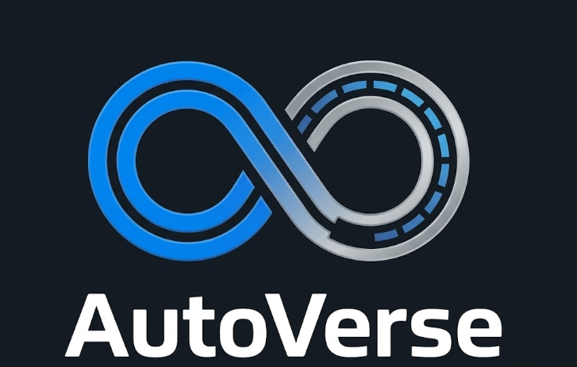

<p align="center">
  <picture>
    <source media="(prefers-color-scheme: dark)" srcset="docs/assets/autoverse-banner.png">
    <source media="(prefers-color-scheme: light)" srcset="app/src/main/res/drawable-nodpi/autoverse_logo.png">
    
  </picture>
</p>

<h1 align="center">AutoVerse</h1>

<p align="center">A fast car cockpit launcher for Android head units and phones.</p>

<p align="center">
  <a href="releases"></a>
  
  
  
  
</p>

---

## Overview

AutoVerse replaces the home screen with a glanceable car cockpit: a live map
that follows the car, your music, GPS speed, and every app one tap away. It is
built with Kotlin and Jetpack Compose, renders the map natively on the GPU
(MapLibre Native), runs with no account, backend, API key or paid service, and
is tuned for slow head units.

## Features

**Home cockpit** — live map (~60%), music (~20%) and speed (~20%) on every
screen size; the speed panel switches to the incoming call while a call rings
(optional).

**Live map** — MapLibre Native on free OpenFreeMap vector tiles
(© OpenStreetMap contributors). One shared map instance for Home and Maps,
created after the first frame with the engine loaded off the main thread;
follows the car heading-up above 8 km/h; movement from 1 Hz GPS is
interpolated; frame cap 30 fps on the Constrained profile with a lite style;
200 MB tile cache for offline reuse; Diagnostics shows measured fps.

**Navigation** — "Open Google Maps" and typed destinations hand off to Google
Maps (or Waze / the user's map app) with tap-time install checks and an honest
"didn't come to the front" message when Android does not show the app.
Recent and saved destinations.

**Apps** — All Apps (~70%) with search and categories; Recently Used (~30%,
AutoVerse's own launch history), collapsible and clearable.

**Music** — the active media session: artwork, play/pause, skip, and the
player's queue where it provides one.

**Speed & OBD-II** — Speed page with trip distance/time, top speed and
weather; Bluetooth ELM327 adapters for RPM, coolant, fuel level and fault codes.

**Themes** — 12 themes, all included.

## Download

**[AutoVerse 1.0.0 APK](releases/AutoVerse-1.0.0-release.apk)** (sideload) ·
**[AutoVerse 1.0.0 AAB](releases/AutoVerse-1.0.0.aab)** (Google Play upload) —
SHA-256 in [`releases/SHA256SUMS.txt`](releases/SHA256SUMS.txt)

Install: `adb install AutoVerse-1.0.0-release.apk`, then choose AutoVerse as
the Home app (the first-run setup offers the picker).

## Build from source

JDK 17 and the Android SDK (platform 36, build-tools 36.0.0). Gradle 8.14.6
wrapper, Android Gradle Plugin 8.13.2, Kotlin 2.2.21.

```powershell
.\gradlew.bat :app:assembleDebug        # debug APK
.\gradlew.bat :app:bundleRelease        # Play App Bundle
.\gradlew.bat :app:testDebugUnitTest    # 484 JVM unit tests
.\gradlew.bat :app:lintDebug
```

Release builds are signed when `keystore.properties` exists at the repo root
(or the `AUTOVERSE_RELEASE_*` environment variables are set). The key itself
lives outside the repository.

## Play Store release

See [`docs/store/`](docs/store): launch checklist with the on-device go/no-go
test, privacy policy, store listing, and Data-safety answers.

## Permissions & privacy

- **Location** — foreground only (while AutoVerse is on screen): speed, map
  position, weather. Weather receives the location rounded to ~1 km; nothing
  else leaves the device.
- **Notification access** — media sessions only; notifications are never read.
- **Phone state** — optional incoming-call panel, requested on tap.
- **Bluetooth connect** — only for an OBD-II adapter you connect.
- **Internet** — map tiles (OpenFreeMap), weather (Open-Meteo), artwork URLs
  supplied by music apps. No microphone, no `QUERY_ALL_PACKAGES`, no analytics,
  ads or accounts.

## Documentation

| Doc | Contents |
| --- | --- |
| [store/](docs/store) | Launch checklist, privacy policy, Play listing, Data safety |
| [map-integration.md](docs/map-integration.md) | Why the map is MapLibre + OpenFreeMap; options and licences |
| [map-embedding-investigation.md](docs/map-embedding-investigation.md) | Can the installed Google Maps app be embedded? Findings |
| [adaptive-layout.md](docs/adaptive-layout.md) | Responsive layout policy |
| [performance-profiles.md](docs/performance-profiles.md) | Constrained / Balanced / Enhanced |
| [media-integration.md](docs/media-integration.md) | Media sessions and now-playing |
| [navigation-handoff.md](docs/navigation-handoff.md) | Destination hand-off |
| [permissions-and-privacy.md](docs/permissions-and-privacy.md) | Permission inventory |
| [third-party-licenses.md](docs/third-party-licenses.md) | Third-party notices |

## Status

**1.0.0** — release candidate for Google Play: targets Android 16, 16 KB
page-size compliant, signed APK + AAB. Not yet verified on a head unit — run
section A of [`docs/store/LAUNCH-CHECKLIST.md`](docs/store/LAUNCH-CHECKLIST.md)
before publishing. Changes since 0.28.5: toolchain upgrade (AGP 8.13.2,
Kotlin 2.2.21, MapLibre 13.7.1, SDK 36); map created after the first frame
with the engine loaded off-thread, lite style on Constrained, Home sections
memoised against per-second GPS recomposition; GPS now runs whenever
AutoVerse is visible (it previously stopped after leaving the Speed page);
unreachable WebView cockpit (with a Google-tile URL) and unreachable voice
features removed (no microphone permission, ~7 MB smaller); weather location
rounded to ~1 km; first launch no longer jumps to system settings; predictive
back on Home consumed; all themes included (paid app).

## License

No license has been chosen for this project yet; until one is added, all
rights are reserved.
