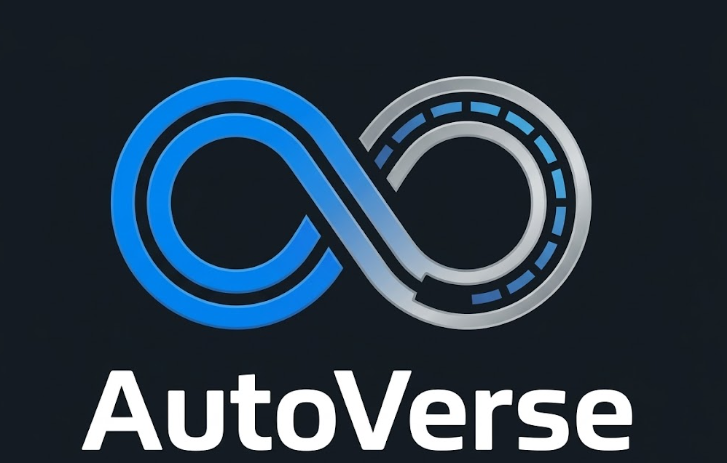

<p align="center">
  <picture>
    <source media="(prefers-color-scheme: dark)" srcset="docs/assets/autoverse-banner.png">
    <source media="(prefers-color-scheme: light)" srcset="app/src/main/res/drawable-nodpi/autoverse_logo.png">
    
  </picture>
</p>

<h1 align="center">AutoVerse</h1>

<p align="center">A fast car cockpit launcher for Android head units and phones.</p>

<p align="center">
  <a href="releases"></a>
  
  
  
  
</p>

---

## Overview

AutoVerse replaces the home screen with a glanceable car cockpit: a live map
that follows the car, your music, GPS speed, and every app one tap away. It is
built with Kotlin and Jetpack Compose, renders the map natively on the GPU
(MapLibre Native), runs with no account, backend, API key or paid service, and
is tuned for slow head units.

## Features

**1.7 — phone connection (optional, Car → Phone)**
- **AutoVerse Remote:** scan a QR code and a remote opens in the phone's browser. It works on iPhone and Android with no app to install. It can control music and volume, send a place or Google Maps link to the car, show the ETA, and end the trip. It runs over the phone's hotspot, is guarded by a one-time pairing code, and is off until you turn it on.
- **Bluetooth:** a guide to pair the phone once.
- **Spotify Connect:** a tip for moving the phone's Spotify to the car.

**1.6 — premium redesign**
- **Look:** Inter typeface; a graphite palette with borderless panels; four themes; the clock moved into the rail, so there is no top bar.
- **Map:** a new night map (recoloured OpenFreeMap "liberty": warm highways, blue water, green parks, larger labels).
- **Driving:** a tilted look-ahead driving camera with an arrow puck, a big turn card and ETA bar, and the map grows to 70% on Home while guiding.
- **Maps screen:** shows only the map.
- **Share from Google Maps:** shares and Google Maps links open on AutoVerse's map.

**1.5 highlights** — dark-first premium design (big glanceable speed with the
road's speed-limit sign, artwork-tinted music panel, header-free map, smooth
screen fades that switch off automatically on entry-level units), full screen
by default, Edit home, speed-limit & speed-camera warnings, Hindi directions
and voice, petrol/CNG/EV/toilets/food nearby and along the route, music
resumes when the car starts, "continue your trip?", Home/Work shortcuts, and a
**Car** page: automatic trip log with fuel cost, service/PUC/insurance
reminders (Home banner), speaker test and an honest head-unit health check.

**Home cockpit** — live map (~60%), music (~20%) and speed (~20%) on every
screen size; the speed panel switches to the incoming call while a call rings
(optional).

**Live map** — MapLibre Native on free OpenFreeMap vector tiles
(© OpenStreetMap contributors). One shared map instance for Home and Maps,
created after the first frame with the engine loaded off the main thread;
follows the car heading-up above 8 km/h; movement from 1 Hz GPS is
interpolated; frame cap 30 fps on the Constrained profile with a lite style;
200 MB tile cache for offline reuse; Diagnostics shows measured fps.

**Navigation (in AutoVerse)** — search any place in India, see the route
on AutoVerse's own map, and drive with turn-by-turn guidance: next-turn
banner, "then" hint, arrival time, spoken instructions (Android TTS, muteable)
and automatic rerouting. Routes are calculated **on the head unit** by the
embedded BRouter engine (MIT) — no routing server, no per-route cost, works in
network dead zones. Road data for an area (15–60 MB per 5°×5° region) is
downloaded once, automatically, the first time you navigate there. Place
search uses Photon (OpenStreetMap). Google Maps remains an optional fallback.

**Apps** — All Apps (~70%) with search and categories; Recently Used (~30%,
AutoVerse's own launch history), collapsible and clearable.

**Music page** — big now-playing view (artwork, seek bar, large play/pause
and skip) for whatever is playing, plus:
- **My music** — AutoVerse's own player (Media3/ExoPlayer) for songs on a USB
  drive, SD card or the unit: songs, albums, artists and folders, search,
  shuffle. A plugged-in USB stick appears automatically. Keeps playing in
  the background, handles audio focus, works with steering-wheel buttons.
- **Music apps** — browse and start playlists/songs from apps that share their
  library with car systems (most local players, many radio/podcast apps; some
  streaming apps refuse, and the page says so with an "Open app" button).
- **Up next** — the playing app's queue, tap to jump.
Home's music card keeps play/pause/skip and opens the Music page.

**Speed & OBD-II** — Speed page with trip distance/time, top speed and
weather; Bluetooth ELM327 adapters for RPM, coolant, fuel level and fault codes.

**Themes** — 12 themes, all included.

## Download

**[AutoVerse 1.0.1 APK](AutoVerse-1.0.1-release.apk)** (sideload, at the repo
root) — SHA-256 in [`releases/SHA256SUMS.txt`](releases/SHA256SUMS.txt)

Install: `adb install AutoVerse-1.0.1-release.apk`, then choose AutoVerse as
the Home app (the first-run setup offers the picker).

## Build from source

JDK 17 and the Android SDK (platform 36, build-tools 36.0.0). Gradle 8.14.6
wrapper, Android Gradle Plugin 8.13.2, Kotlin 2.2.21.

```powershell
.\gradlew.bat :app:assembleDebug        # debug APK
.\gradlew.bat :app:bundleRelease        # Play App Bundle
.\gradlew.bat :app:testDebugUnitTest    # 484 JVM unit tests
.\gradlew.bat :app:lintDebug
```

Release builds are signed when `keystore.properties` exists at the repo root
(or the `AUTOVERSE_RELEASE_*` environment variables are set). The key itself
lives outside the repository.

## Play Store release

See [`docs/store/`](docs/store): launch checklist with the on-device go/no-go
test, privacy policy, store listing, and Data-safety answers.

## Permissions & privacy

- **Location** — foreground only (while AutoVerse is on screen): speed, map
  position, weather. Weather receives the location rounded to ~1 km; nothing
  else leaves the device.
- **Notification access** — media sessions only; notifications are never read.
- **Phone state** — optional incoming-call panel, requested on tap.
- **Bluetooth connect** — only for an OBD-II adapter you connect.
- **Internet** — map tiles (OpenFreeMap), weather (Open-Meteo), artwork URLs
  supplied by music apps. No microphone, no `QUERY_ALL_PACKAGES`, no analytics,
  ads or accounts.

## Documentation

| Doc | Contents |
| --- | --- |
| [store/](docs/store) | Launch checklist, privacy policy, Play listing, Data safety |
| [map-integration.md](docs/map-integration.md) | Why the map is MapLibre + OpenFreeMap; options and licences |
| [map-embedding-investigation.md](docs/map-embedding-investigation.md) | Can the installed Google Maps app be embedded? Findings |
| [adaptive-layout.md](docs/adaptive-layout.md) | Responsive layout policy |
| [performance-profiles.md](docs/performance-profiles.md) | Constrained / Balanced / Enhanced |
| [media-integration.md](docs/media-integration.md) | Media sessions and now-playing |
| [navigation-handoff.md](docs/navigation-handoff.md) | Destination hand-off |
| [permissions-and-privacy.md](docs/permissions-and-privacy.md) | Permission inventory |
| [third-party-licenses.md](docs/third-party-licenses.md) | Third-party notices |

## Status

**1.0.1** — bugfix on the 1.0.0 release candidate: the first-run setup's
**Continue** button now advances to the next page (it previously did nothing;
only Skip and the final "Open the cockpit" action worked).

**1.0.0** — release candidate for Google Play: targets Android 16, 16 KB
page-size compliant, signed APK + AAB. Not yet verified on a head unit — run
section A of [`docs/store/LAUNCH-CHECKLIST.md`](docs/store/LAUNCH-CHECKLIST.md)
before publishing. Changes since 0.28.5: toolchain upgrade (AGP 8.13.2,
Kotlin 2.2.21, MapLibre 13.7.1, SDK 36); map created after the first frame
with the engine loaded off-thread, lite style on Constrained, Home sections
memoised against per-second GPS recomposition; GPS now runs whenever
AutoVerse is visible (it previously stopped after leaving the Speed page);
unreachable WebView cockpit (with a Google-tile URL) and unreachable voice
features removed (no microphone permission, ~7 MB smaller); weather location
rounded to ~1 km; first launch no longer jumps to system settings; predictive
back on Home consumed; all themes included (paid app).

## License

No license has been chosen for this project yet; until one is added, all
rights are reserved.
